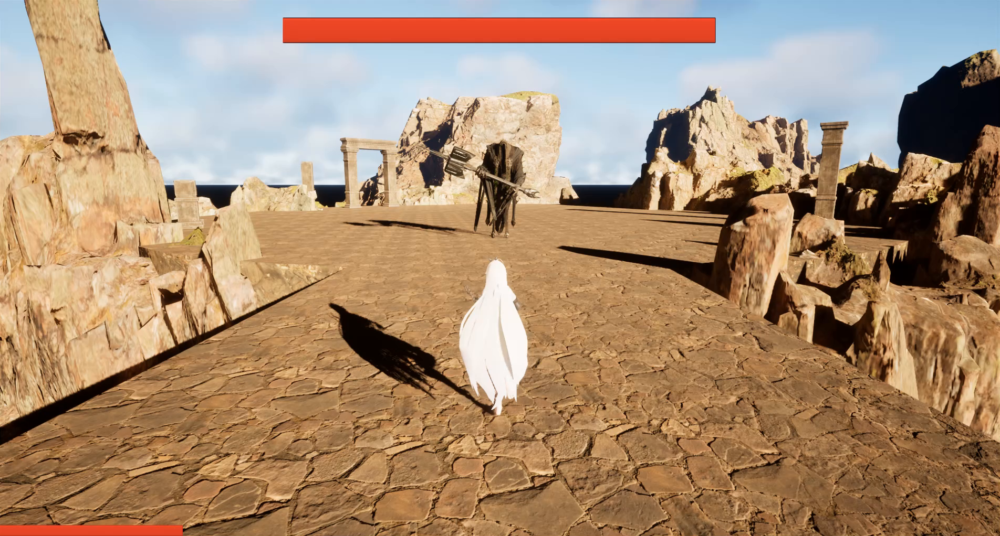

# Eye of the Storm

날씨 변화가 전투 규칙과 연동되는 Unreal Engine 5 소울라이크 게임입니다. 엔진 기본 하늘과 구름 시스템 대신 자체 제작한 볼류메트릭 날씨 렌더러를 UE5 RDG에 직접 삽입해 구현했습니다.

플레이 영상 링크: https://youtu.be/Ty0jbDRZoKc

| 항목 | 내용 |
| --- | --- |
| **개발 형태** | 1인 개발 (날씨 렌더링 플러그인 `Plugins/VW`는 직접 구현, 게임 모듈 및 에디터 도구는 AI 페어 프로그래밍 활용) |
| **개발 기간** | 2026.11.02 ~ 2026.11.22 |
| **개발 환경** | Unreal Engine 5.7, C++, HLSL |
| **핵심 구현** | UE5 RDG 커스텀 볼류메트릭 날씨 렌더링 플러그인, 보스 체력 연동 실시간 날씨 전환 및 3페이즈 보스전 액션 |
| **문서 바로가기** | [기술 설계 문서](Docs/TechnicalDesign.md), [AI 엔지니어링 프로세스](Docs/AIWorkflow.md) |

## 기술적인 특징

- **UE5 `SceneViewExtension` 및 RDG 커스텀 패스 삽입**: 엔진 기본 SkyAtmosphere와 VolumetricCloud를 사용하지 않고, 자체 제작한 Vulkan 렌더러([VolumetricWeather](https://github.com/Shell4026/VolumetricWeather))를 UE5 RDG로 이식했습니다. 대기 산란 LUT, 태양 깊이 기반 체적 그림자, 1/16 픽셀 시간적 재투영을 적용한 레이마칭 구름, 최종 합성 패스를 직접 구성해 GPU 약 1ms 내에 렌더링합니다. ([상세 설계](Documentation/TechnicalDesign.md#패스))
- **행성 스케일 float 정밀도 유지를 위한 경계 좌표계 변환**: UE 좌표계로 행성 반지름을 직접 처리하면 float 정밀도가 문제가 됩니다. 이를 방지하고 원본 셰이더와의 검증 일관성을 유지하기 위해, C++에서 셰이더로 파라미터를 전달하는 지점에서 좌표계와 단위를 한 번 변환합니다. ([상세 설계](Documentation/TechnicalDesign.md#좌표계는-경계에서-한-번만-변환))
- **UE 직교 SceneCapture 원평면 제약 우회**: 태양 방향 체적 그림자(빛줄기)용 깊이 캡처 과정에서 UE 기본 직교 SceneCapture(`BuildOrthoMatrix`)의 원평면이 약 2.6km로 고정되어 10km 캡처 깊이가 손실되는 문제를 확인했습니다. 커스텀 직교 투영 행렬을 적용해 캡처 거리 10km, 원평면 20km로 확장해 해결했습니다. ([상세 설계](Documentation/TechnicalDesign.md#태양-깊이-캡처-범위))
- **몽타주 노티파이를 이용한 슬로우 모션**: 애니메이션을 수정하지 않고 특정 구간을 느리게 하고 싶으면 그 부분에 노티파이를 놓게 하는식으로 수정이 편해지게했습니다.

## GPU 성능 요약

RTX 3060 Ti, 1920x1080, Standalone 기준 패스별 GPU 소요 시간(ms)입니다.

| 패스 | 맑음 (ms) | 폭풍 (ms) |
| --- | --- | --- |
| **VW 전체** | **1.03** | **0.78** |
| VW.SkyViewLUT | 0.09 | 0.09 |
| VW.AerialPerspectiveLUT | 0.02 | 0.03 |
| VW.Cloud | 0.70 | 0.49 |
| VW.Composite | 0.20 | 0.16 |
| **프레임 전체** | **7.17** | **6.94** |

구름 레이마칭에 투과율 조기 종료 코드가 있어, 구름 밀도가 높은 폭풍 구간이 맑음 구간보다 VW 전체 기준 0.25ms 적게 소요됩니다.  
날씨가 고정된 프레임에서는 정적 대기 LUT를 다시 굽지 않도록 서브시스템에서 변경 여부를 필터링합니다. ([성능 분석 상세](Documentation/TechnicalDesign.md#성능))

## 게임플레이 개요

폭풍이 몰려오는 절벽 아레나에서 보스 1체와 전투하며, 보스 체력 구간에 따라 날씨와 전투 양상이 실시간으로 변합니다.

| 페이즈 | 보스 체력 | 날씨 | 전투 양상 |
| --- | --- | --- | --- |
| 1 | 100% ~ 66% | 해질녘, 맑음 | 기본 보스 패턴 |
| 2 | 66% ~ 33% | 짙은 구름과 안개 | 시야 제한 |
| 3 | 33% ~ 0% | 폭풍과 번개 | 예고 장판 이후 낙뢰 회피 |

- **날씨 상태 머신 및 체력 연동 컴포넌트**: 월드 서브시스템(`UStormWeatherSubsystem`)이 3개 날씨 프리셋을 연속 보간하며, `UStormHealthWeatherComponent`로 보스 체력과 날씨 제어를 분리했습니다. 보스를 처치하면 맑음 상태로 복귀합니다.
- **번개와 낙뢰**: 3페이즈 진입 시 `UStormLightningComponent`가 플레이어 위치와 아레나 무작위 지점에 예고 장판을 생성하고 1.2초 뒤 낙뢰를 떨어뜨리며, 회피 무적 프레임으로 회피할 수 있습니다.
- **전투 및 보스 AI**: 락온, 버퍼 입력과 무적 프레임이 적용된 회피, 스윕 판정 기반 3타 콤보와 히트스톱, 비헤이비어 트리 기반 보스 패턴, 전투 중 비용을 줄이기 위해 사망 시점에만 머티리얼을 교체하는 보스 사망 디졸브를 구현했습니다.

## 문서

- [기술 설계 문서](Documentation/TechnicalDesign.md): 프로젝트 구조, 날씨 렌더링 패스 설계 판단, GPU 성능 측정, 게임플레이 시스템, 엔진 및 렌더링 디버깅 사례
- [AI 엔지니어링 프로세스](Documentation/AIWorkflow.md): 개발 역할 경계, 코드 규약 및 에셋 그라운딩 품질 통제 파이프라인, AI 생성 설계와 추론의 검증 및 교정 사례

## 외부 리소스

| 리소스 | 출처 | 용도 |
| --- | --- | --- |
| 플레이어 캐릭터 | 직접 제작 | 플레이어 |
| Paragon: Sevarog | Epic Games (Fab) | 보스 |
| Massive Nordic Coastal Cliff, Huge Nordic Coastal Cliff, Sharp Cliff | Quixel Megascans (Fab) | 절벽 |
| Stone Pillar - Intact & Broken Variations | GriidArt (Fab) | 폐허 기둥 |
| monastery_stone_floor, rock_face_04 | Poly Haven (CC0) | 아레나 바닥과 절벽 재질 |
| Mixamo | Adobe | 애니메이션 |
| [KawaiiPhysics](https://github.com/pafuhana1213/KawaiiPhysics) | pafuhana1213 | 보조 물리 플러그인 |

외부 에셋 라이선스 정책에 따라 에셋을 비공개 서브모듈(`Content/Assets`)로 분리한 소스 코드 열람용 저장소입니다. 실제 구동 화면은 상단 플레이 영상에서 확인할 수 있습니다.
